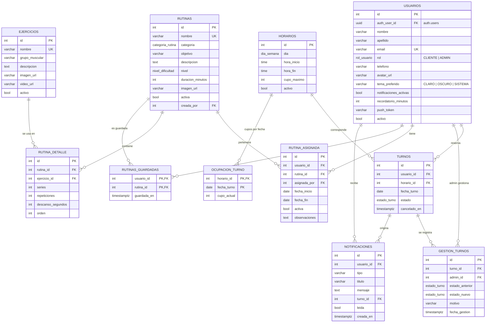

# Modelo de datos de FitTime (PostgreSQL)

Scripts, en orden de ejecución: `database/init_fittime.sql` → `database/02_mejoras_fittime.sql` → `database/03_cuentas_prueba.sql`.

## 1. Diagrama entidad-relación

## 2. Diferencias con el diagrama ER del documento (y por qué)

| Diagrama original | Implementación | Motivo |
|---|---|---|
| `USUARIO.contraseña` | No se guarda en `usuarios` | Supabase Auth guarda el hash (bcrypt) en `auth.users`. `usuarios.auth_user_id` vincula ambas tablas. |
| `USUARIO.tipo_usuario` | `usuarios.rol` (enum `CLIENTE` / `ADMIN`) | Un enum impide valores inválidos. |
| `HORARIO.cupos_disponibles` | `horarios.cupo_maximo` + tabla `ocupacion_turno` | Los cupos dependen de la **fecha**: el lunes 20 y el lunes 27 son turnos distintos. |
| `TURNO.hora` | Se obtiene de `horarios.hora_inicio` | Evita datos duplicados (3.ª forma normal). |
| `EJERCICIO.id_rutina`, `series`, `repeticiones` | Tabla intermedia `rutina_detalle` | Un ejercicio (ej. Sentadilla) se usa en varias rutinas con distintas series. Es una relación N:M. |
| `GESTION_TURNOS.estado_turno` | `estado_anterior`, `estado_nuevo`, `motivo`, `admin_id` | Auditoría completa: quién cambió qué y por qué. |
| — | `rutinas.categoria` | RF7: rutinas por categoría (Fuerza, Cardio, Tren superior, Tren inferior, Cuerpo completo, Movilidad). |
| — | `rutinas_guardadas` | RF8: "rutinas guardadas" en el perfil. |
| — | `notificaciones` | Requisito 8: historial de confirmaciones, cancelaciones y rutinas asignadas. |

## 3. Diccionario de datos

### Tipos enumerados

| Tipo | Valores |
|---|---|
| `rol_usuario` | `CLIENTE`, `ADMIN` |
| `estado_turno` | `CONFIRMADO`, `CANCELADO`, `COMPLETADO`, `AUSENTE` |
| `dia_semana` | `LUNES` … `DOMINGO` |
| `nivel_dificultad` | `PRINCIPIANTE`, `INTERMEDIO`, `AVANZADO` |
| `categoria_rutina` | `FUERZA`, `CARDIO`, `TREN_SUPERIOR`, `TREN_INFERIOR`, `CUERPO_COMPLETO`, `MOVILIDAD` |

### Restricciones de integridad importantes

| Restricción | Qué garantiza |
|---|---|
| `check_horario_valido` (`hora_fin > hora_inicio`) | No hay franjas imposibles. |
| `cupo_maximo > 0`, `ocupacion_turno.cupo_actual >= 0` | Cupos coherentes. |
| Índice único parcial `uq_turno_confirmado` | Un cliente no puede tener dos turnos confirmados en el mismo horario y fecha. |
| `uq_horarios_dia_horas` | No se duplican franjas. |
| `uq_rutina_ejercicio` | Un ejercicio aparece una sola vez por rutina. |
| PK compuesta en `rutinas_guardadas` | No se guarda dos veces la misma rutina. |
| `ON DELETE RESTRICT` en `turnos → horarios` | No se puede borrar un horario con turnos: se da de baja con `activo = false`. |

### Funciones (API de negocio, se llaman con `supabase.rpc(...)`)

| Función | Quién | Qué hace |
|---|---|---|
| `obtener_horarios_disponibles(dia, fecha, hora)` | Todos | Franjas del día con cupo ocupado para la próxima fecha. |
| `reservar_turno(horario_id, fecha)` | Cliente | Reserva validando fecha, día y cupo (atómico). |
| `cancelar_turno(turno_id)` | Cliente | Cancela un turno propio y libera el cupo. |
| `admin_gestionar_turno(turno_id, estado, motivo)` | Admin | Cambia estado (asistió, ausente, cancelado) y lo audita. |
| `admin_asignar_rutina(usuario_id, rutina_id, obs)` | Admin | Asigna rutina, desactiva la anterior y notifica. |
| `admin_actualizar_usuario(usuario_id, rol, activo)` | Admin | Cambia rol o da de baja (no a sí mismo). |
| `admin_estadisticas()` | Admin | JSON con KPIs para el dashboard. |

### Triggers

| Trigger | Tabla | Efecto |
|---|---|---|
| `on_auth_user_created` | `auth.users` | Crea el perfil `CLIENTE` y le asigna una rutina inicial. |
| `turnos_capacity_trigger` | `turnos` | Suma/resta cupo en `ocupacion_turno`; lanza `CUPO_COMPLETO`. |
| `turnos_notificar` | `turnos` | Notificación de confirmación o cancelación. |
| `rutina_asignada_notificar` | `rutina_asignada` | Notificación "Nueva rutina asignada". |
| `usuarios_set_actualizado_en` | `usuarios` | Actualiza la fecha de modificación. |
